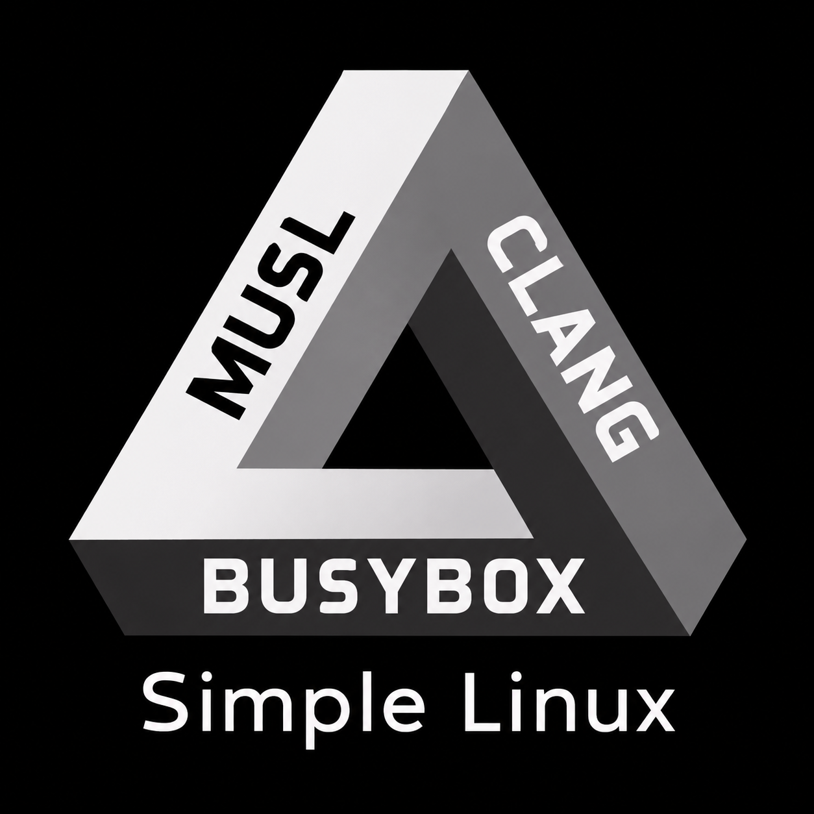
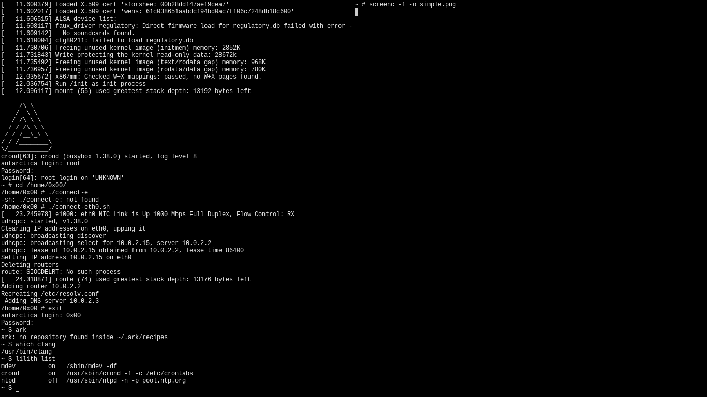
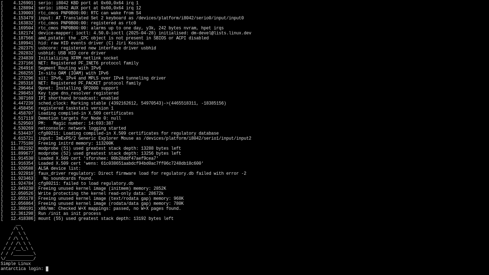

# SimpleLinux



> **WORK IN PROGRESS**

**SimpleLinux (SL)** is a minimal, developer-first Linux distribution built from source, using the **Linux kernel, musl libc, LLVM/Clang, and dynamically linked BusyBox**.

Its goal is to provide a complete development environment with everything needed to build, maintain, and rebuild the system itself, even without an internet connection, while remaining practical and user-friendly. It aims to provide useful quality-of-life features without compromising the KISS philosophy. A good example is using `su` instead of `sudo` or `doas`, while retaining their familiar interfaces through a simple wrapper.

Packages are managed by [Ark](https://github.com/KrzysztofMarciniak/Ark). The init system is BusyBox init, configured through `/etc/inittab`, with services managed by Lilith. No D-Bus, no polkit, no unnecessary complexity.

> “When I was a child, I spoke as a child, I understood as a child, I thought as a child; but when I became a man, I put away childish things.”
>
> — 1 Corinthians 13:11 (KJV)

SimpleLinux has three planned profiles:

- **Bare** — the essentials: Linux, musl, and BusyBox.
- **Minimal** — a lightweight C development and system-maintenance environment designed to support rebuilding the base system and working offline.
- **Minimal + X11** — Minimal extended with a lightweight graphical environment, networking tools, and additional applications. Designed to be customized by the user.

The project is under active development. Profiles and package availability may change as components are ported, built, and tested. The package lists below describe intended contents, not necessarily the current state of every build.




## Building

Build the ISO and its required components:

```sh
make
```

Rebuild the root filesystem and regenerate the initramfs and ISO after changing the root filesystem configuration, `inittab`, or related Makefile rules:

```sh
make rootfs
```

Remove build output and generated ISO files while preserving downloaded source archives:

```sh
make clean
```

Boot the ISO using QEMU:

```sh
./run_qemu.sh
```

## Preinstalled programs

The following lists describe the intended contents of each profile. Not every package is necessarily integrated yet.

### Bare

The minimum bootable system:

- Linux kernel
- musl libc
- BusyBox

### Minimal

## Roadmap

**Goal:** A bootable, installable, musl-based Linux system with LLVM/Clang, BusyBox, Ark, and the tools required to rebuild the entire system from source.

### 1. Toolchain and base system
- [x] Add make
- [ ] Finalize the LLVM build (Clang + LLD + compiler-rt).
- [ ] Install the LLVM toolchain into the build environment outside the root filesystem.
- [ ] Include the required LLVM toolchain binaries and libraries in the Minimal ISO.
- [ ] Ensure Ark recognizes the installed Clang toolchain and detects whether it is up to date.
- [ ] Verify that Clang and LLD compile and link programs against musl.
- [ ] Verify dynamic linking with musl, including the correct dynamic loader.
- [ ] Ensure the target system has no glibc dependencies.
- [x] Build and run the Ark hello-world test project.
- [ ] Verify that Ark can compile and install programs using the installed toolchain.

### 2. Core development environment

- [x] Integrate Ark into the Minimal profile.
- [ ] Add `pkg-config`, GNU Make, OpenSSL and CA certificates.
- [ ] Add essential development utilities: binutils, bison, flex, bc, patch and diffutils.
- [ ] Add manual pages.
- [ ] Add the required headers and development files for rebuilding the base system.
- [ ] Verify that the installed environment can rebuild the Linux kernel, musl, BusyBox and LLVM/Clang from source.

### 3. Installation

- [ ] Create `install.sh`.
- [ ] Make `make minimal` generate a bootable Minimal ISO.
- [ ] Ensure the ISO boots from USB and in QEMU.
- [ ] Implement installation to an encrypted disk.
- [ ] Support disk partitioning and filesystem creation.
- [ ] Configure disk encryption using LUKS/dm-crypt.
- [ ] Install and configure GRUB.
- [ ] Generate the installed system's initramfs.
- [ ] Configure the bootloader to unlock the encrypted root filesystem.
- [ ] Configure the installed system to boot independently of the installation media.
- [ ] Test installation, rebooting, recovery and shutdown on QEMU and physical hardware.

**Installation policy:** The initial installer supports encrypted installations only. No unencrypted installation option is provided.

### 4. Self-hosting and offline development

- [ ] Ensure the installed system can rebuild its own base components using Ark.
- [ ] Verify that Ark can rebuild and reinstall musl, LLVM/Clang, BusyBox and the kernel.
- [ ] Ensure source archives and required build dependencies can be retained locally.
- [ ] Verify that package builds work without an active internet connection when their sources and dependencies are available locally.
- [ ] Add a `run-me.sh` script documenting how to rebuild the installed system and its components.
- [ ] Test rebuilding the system from a clean installation.

### 5. Service management

- [x] Finalize Lilith and integrate it into the Minimal profile.
- [ ] Verify service addition, removal, starting and stopping.
- [ ] Ensure service changes are correctly reloaded by BusyBox init.
- [ ] Configure the required BusyBox init options for stopping removed services.
- [ ] Document service persistence and the `INITTAB` configuration.
- [ ] Keep optional services disabled by default.

**Default services:**
- `mdev` — device management.
- `crond` — scheduled tasks.
- `ntpd` — time synchronization (disabled by default).

**Optional services and utilities:**
- [ ] Wi-Fi support using `wpa_supplicant` and DHCP.
- [ ] Wi-Fi service integration with Lilith (disabled by default).
- [ ] ACPI event handling using `acpid` (disabled by default).
- [ ] Laptop power management using TLP (disabled by default).

No D-Bus, systemd, elogind, polkit or heavyweight service-management framework is required.

### 6. User environment

- [ ] Create a default user with a randomly generated hexadecimal username (e.g. `0x00`).
- [ ] Generate a hostname from a predefined list.
- [ ] Configure the user's home directory.
- [ ] Install `run-me.sh` in the user's home directory.
- [x] Provide `sudo` and `doas` wrappers using `su root -c`.

### 7. Validation

- [ ] Boot the Minimal ISO in QEMU.
- [ ] Install SimpleLinux to an encrypted virtual disk.
- [ ] Boot the installed system without the ISO.
- [ ] Verify that BusyBox and all installed programs use musl.
- [ ] Verify that no glibc runtime or libraries are required.
- [ ] Verify dynamic linking of BusyBox and Ark-built programs.
- [ ] Verify that Clang and LLD work after installation.
- [ ] Rebuild a test program using Ark.
- [ ] Rebuild at least one base component using Ark.
- [ ] Verify that the system can be maintained offline.

### 8. Extra 
- [ ] add support for https://github.com/fwgs/xash3d-fwgs
- [ ] add support for https://dillo.org/

- [ ] During installation, ask the user whether they want to download a collection of public-domain and openly licensed plain-text resources.
  - C programming books and tutorials.
  - C standard library references.
  - POSIX and Unix programming guides.
  - Linux system programming resources.
  - Shell scripting guides.
  - Networking and TCP/IP basics.
  - Store everything under `/usr/share/docs/`.
  - Include license and attribution information for every resource.
  - Allow installation without an internet connection by skipping this step.

- [ ] Write SimpleLinux-specific plain-text guides under `/usr/share/docs/simplelinux/`.
  - [ ] **Lilith guide** — adding, removing, starting, stopping, and listing services.
  - [ ] **Ash shell guide** — shell basics, commands, scripting, and configuration.
  - [ ] **System rebuilding guide** — recompiling the kernel, musl, BusyBox, and LLVM.
  - [ ] **Ark guide** — installing packages, building from source, and managing packages.
  - [ ] **System installation guide** — installation, disk encryption, booting, and recovery.
  - [ ] **Filesystem guide** — root filesystem layout and important directories.
  - [ ] **Networking guide** — configuring Ethernet, Wi-Fi, DHCP, and SSH.
  - [ ] **Troubleshooting guide** — common problems and recovery procedures.

- [ ] Keep documentation in plain `.txt` format.
- [ ] Make documentation readable with standard tools such as `less`, `more`, and `cat`.

**Completion goal:** A working, encrypted, bootable and self-hosting SimpleLinux installation with a musl-only runtime, LLVM/Clang toolchain, BusyBox userland and Ark package management.

**Goals of Minimal Build:** Rebuild the base system, develop primarily in C, and perform lightweight web access from the command line.

## Service Manager


SimpleLinux uses BusyBox `init` as PID 1. **Lilith** is a small service manager on top of it, written in POSIX `sh` and using only BusyBox applets. It has no extra dependencies and no daemon of its own. Services are ordinary `respawn` entries in `/etc/inittab`, which `init` already supervises.

Lilith is installed in the **Minimal** profile.

### Usage

```sh
lilith add "sshd -D -e" ssh     # add a service 
lilith list                     # show services and their state
lilith start ssh                # enable and start a service
lilith stop ssh                 # stop and disable a service
lilith remove ssh               # delete a service entirely
```

`lilith list` prints one line per service:

```
mdev         on   /sbin/mdev -df
crond        on   /usr/sbin/crond -f -c /etc/crontabs
ntpd         off  /usr/sbin/ntpd -n -p pool.ntp.org
```

If no name is given, `add` uses the command's basename, so `lilith add "ntpd -n"` creates a service called `ntpd`.

Commands that change services need root. Run as a normal user, Lilith re-runs itself through `su root`. The Minimal profile also ships `sudo` and `doas` as a thin wrapper around `su root -c`. There is no sudoers file and no per-user rules; it asks for the root password.

### How it works

Each managed service is a marker line followed by its entry:

```
#lilith:ntpd
::respawn:/usr/sbin/ntpd -n -p pool.ntp.org
```

- **`start`** uncomments the entry, **`stop`** comments it out, and **`remove`** deletes both lines.
- **`add`** inserts new services above the `#lilith-end` line.
- After every change, Lilith sends `SIGHUP` to `init` so it re-reads `/etc/inittab`.

Lines without a `#lilith:` marker (mounts, `login`, shutdown handling) are never touched.

### Shipped services

| Service | Default | Description |
|---------|---------|-------------|
| `mdev`  | on      | device hotplug handling |
| `crond` | on      | cron daemon |
| `ntpd`  | off     | time sync (needs a network connection first) |

### Writing services

- Services **must run in the foreground** (`sshd -D`, `crond -f`, `ntpd -n`). `init` supervises the process directly, so a daemon that forks into the background will be respawned in a loop.
- `init` respawns a crashed service immediately, with no backoff and no dependency ordering. For a flaky service, wrap it, for example `lilith add "sh -c 'ntpd -n; sleep 5'" ntpd`.

### Persistence

SimpleLinux boots from an initramfs, so changes made with `lilith` live in RAM and are **lost on reboot**. To make a service permanent, add its marker and entry to the `INITTAB` definition in the Makefile (or to `EXTRA_SERVICES`), then run `make rootfs`.

## User

- Creates a default user with a randomly generated hexadecimal username (e.g., `0x00`).
- Sets the hostname to a randomly selected name from a predefined list (e.g., `arctic`, `tundra`, `greenland`, `borealis`, `glacier`, `everest`, `alps`, `denali`, `atlas`, `iceland`, `archipelago`, `boreal`).
- Places a `run-me.sh` script in the user's home directory. The script documents how to rebuild each installed program from source, including musl libc, LLVM/Clang, the Linux kernel, BusyBox, and other available packages.

https://github.com/KrzysztofMarciniak/simple-linux-minimal-repo

## Packages

- Linux kernel, musl libc, and BusyBox build support
- Manual pages
- [Ark](https://github.com/KrzysztofMarciniak/Ark) — source-based package manager
- LLVM/Clang — C compiler and selected development tools
- `pkg-config` — library discovery and build flags
- GNU Make — build automation
- OpenSSL — cryptographic libraries and TLS tools
- CA certificate bundle — HTTPS certificate verification
- `binutils` — assembler, linker, and binary utilities
- `bison` — parser generator
- `flex` — lexical analyzer generator
- `bc` — command-line calculator
- `patch` — source patching
- `diffutils` — file comparison utilities

### Minimal + X11

Minimal, extended with a lightweight graphical environment and additional applications. The goal is to provide a functional graphical workstation while allowing users to choose which additional tools they need.

#### Graphical environment

- X11 — graphical display system, runtime components, and development files
- [MWM](https://github.com/KrzysztofMarciniak/minimal-window-manager) — minimal window manager
- [st](https://st.suckless.org/) — simple terminal emulator
- [dmenu](https://tools.suckless.org/dmenu/) — application launcher
- [img](https://github.com/KrzysztofMarciniak/img) — image viewer
- [redact](https://github.com/KrzysztofMarciniak/redact)
- [screenc](https://github.com/KrzysztofMarciniak/screenc)

#### Networking

- OpenSSH — secure remote access, including the SSH client and optional server support

#### Additional software

Databases, additional programming languages, and other developer tools may be installed as needed. The intention is to keep the base system small rather than bundle every possible application into the default installation.

## Design goals

- **KISS** — keep the base system small and avoid unnecessary dependencies.
- **Offline readiness** — support development and package builds using locally available source archives and dependencies.
- **Developer-first** — provide a practical C development environment with LLVM/Clang and essential build tools.
- **Customizability** — allow users to extend the system without requiring a separate distribution profile for every use case.

## Package management

SimpleLinux uses [Ark](https://github.com/KrzysztofMarciniak/Ark), a source-based package manager developed for the project.

The intended approach is to manage software through source builds, keeping the system customizable and making it possible to inspect and modify the software being installed.

Package availability, dependency handling, and offline build capabilities are under development and may vary by package.

## Development status

SimpleLinux is a work in progress. The profiles and package lists describe the intended direction of the project rather than a guarantee that every component is already available.

Current development focuses on building and integrating the base system, maintaining the root filesystem, generating bootable images, and expanding package support.

Contributions, testing, and feedback are welcome.
